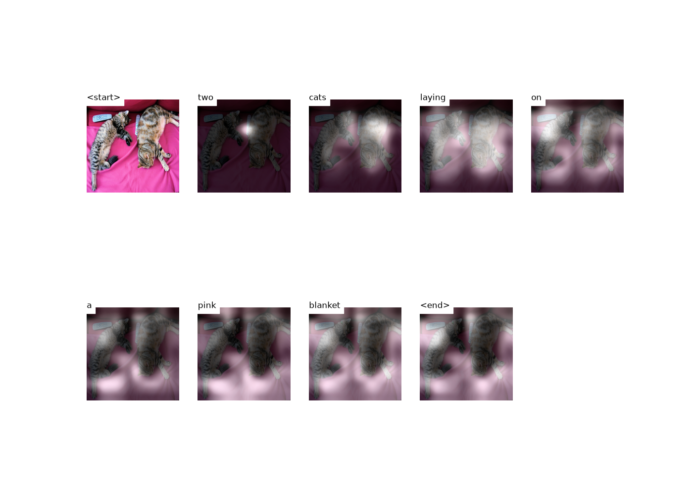

# Hướng dẫn sử dụng: Sinh chú thích cho ảnh (Image Captioning) bằng PyTorch

Tài liệu này dành cho **người mới bắt đầu**. Bạn không cần biết trước về PyTorch hay deep learning. Chỉ cần làm theo từng bước, gõ đúng lệnh, và đối chiếu với kết quả mẫu.

Lộ trình gồm 2 chặng:

1. **Chạy thử trong ~15 phút**: dùng model đã được huấn luyện sẵn để sinh câu mô tả cho ảnh của bạn.
2. **Tự huấn luyện model** trên bộ dữ liệu Flickr8k (~1GB, vài giờ trên GPU laptop).

> Code trong repo đã được chỉnh để chạy với Python 3.10+ và PyTorch 2.x (bản gốc viết cho PyTorch 0.4 nên không còn chạy được). Mọi lệnh trong tài liệu đã được chạy thử trên Windows 11, Python 3.12, PyTorch 2.11, GPU RTX 5060 Laptop 8GB.

---

## Mục lục

1. [Dự án này làm gì?](#1-dự-án-này-làm-gì)
2. [Chuẩn bị máy](#2-chuẩn-bị-máy)
3. [Chạy thử trong 15 phút với model có sẵn](#3-chạy-thử-trong-15-phút-với-model-có-sẵn)
4. [Hiểu mô hình hoạt động thế nào](#4-hiểu-mô-hình-hoạt-động-thế-nào)
5. [Tự huấn luyện trên Flickr8k](#5-tự-huấn-luyện-trên-flickr8k)
6. [Dùng model của chính bạn](#6-dùng-model-của-chính-bạn)
7. [Lỗi thường gặp](#7-lỗi-thường-gặp)
8. [Đi xa hơn](#8-đi-xa-hơn)
9. [Bảng thuật ngữ](#9-bảng-thuật-ngữ)

---

## 1. Dự án này làm gì?

Bạn đưa vào **một bức ảnh**, model trả về **một câu tiếng Anh mô tả ảnh đó**, ví dụ:

> `two cats laying on a pink blanket`

Điểm đặc biệt: model có cơ chế **Attention** ("sự chú ý"). Khi sinh từng từ, nó "nhìn" vào vùng ảnh liên quan nhất. Khi viết chữ `cats`, vùng sáng nằm trên con mèo; khi viết `blanket`, vùng sáng chuyển sang tấm chăn. Bạn sẽ thấy điều này tận mắt ở bước 3.


Dự án cài đặt lại bài báo khoa học [_Show, Attend and Tell_ (2015)](https://arxiv.org/abs/1502.03044). Bản PDF có sẵn trong thư mục `docs/`.

**Cấu trúc repo:**

| File | Vai trò |
|---|---|
| `caption.py` | Sinh câu mô tả cho 1 ảnh và vẽ hình attention. **Dùng nhiều nhất.** |
| `create_input_files.py` | Tiền xử lý dữ liệu: đọc ảnh + câu mô tả, lưu thành file HDF5/JSON để train. |
| `train.py` | Huấn luyện model. |
| `eval.py` | Chấm điểm model trên tập test (điểm BLEU-4). |
| `models.py` | Định nghĩa kiến trúc model: `Encoder`, `Attention`, `DecoderWithAttention`. |
| `datasets.py` | Đọc dữ liệu đã tiền xử lý để đưa vào model. |
| `utils.py` | Hàm phụ trợ: tạo dữ liệu, lưu checkpoint, tính độ chính xác... |

---

## 2. Chuẩn bị máy

### 2.1. Yêu cầu

| Thứ cần có | Ghi chú |
|---|---|
| Windows 10/11, Linux hoặc macOS | Tài liệu viết lệnh cho **Windows PowerShell**; lệnh Linux/macOS ghi chú bên cạnh khi khác. |
| [Python 3.10 – 3.12](https://www.python.org/downloads/) | Khi cài trên Windows, **tick ô "Add python.exe to PATH"**. |
| [Git](https://git-scm.com/downloads) | Để tải code về. |
| GPU NVIDIA (khuyến nghị) | Để **chạy thử** thì CPU là đủ. Để **huấn luyện** thì gần như bắt buộc có GPU (CPU chậm hàng chục lần). |
| ~10GB ổ cứng trống | ~1GB cho model có sẵn, ~5GB cho dữ liệu Flickr8k, ~1GB cho checkpoint. |

Nếu có GPU NVIDIA, cập nhật **driver** mới nhất tại [nvidia.com/drivers](https://www.nvidia.com/Download/index.aspx). Kiểm tra bằng lệnh:

```powershell
nvidia-smi
```

Bạn sẽ thấy tên card và dòng `CUDA Version: 12.x` (hoặc cao hơn) ở góc phải trên. Không cần cài CUDA Toolkit riêng — PyTorch đã kèm sẵn.

### 2.2. Tải code về

Mở **PowerShell** (bấm phím Windows, gõ `powershell`, Enter), rồi:

```powershell
cd D:\              # chọn ổ/thư mục bạn muốn để code
git clone https://github.com/minhnguyen2381/a-PyTorch-Tutorial-to-Image-Captioning.git
cd a-PyTorch-Tutorial-to-Image-Captioning
```

> ⚠️ Hãy clone đúng repo này. Repo gốc của tác giả (`sgrvinod/...`) chưa có các chỉnh sửa tương thích nên sẽ báo lỗi với Python/PyTorch hiện nay.

**Từ đây trở đi, mọi lệnh đều chạy trong thư mục gốc của repo** (thư mục có file `train.py`). Các script đọc/ghi file theo đường dẫn tương đối nên chạy sai thư mục sẽ báo lỗi không tìm thấy file.

### 2.3. Tạo môi trường ảo (virtual environment)

Môi trường ảo là một "hộp" chứa riêng các thư viện cho dự án này, không ảnh hưởng tới Python chung của máy.

```powershell
python -m venv .venv
.venv\Scripts\Activate.ps1
```

Linux/macOS: `python3 -m venv .venv` rồi `source .venv/bin/activate`.

Thành công khi đầu dòng lệnh hiện `(.venv)`. **Mỗi lần mở PowerShell mới, bạn phải chạy lại lệnh `Activate.ps1`.**

> Nếu báo lỗi `running scripts is disabled on this system`, chạy một lần lệnh sau rồi thử lại:
> ```powershell
> Set-ExecutionPolicy -Scope CurrentUser RemoteSigned
> ```

### 2.4. Cài PyTorch

PyTorch phải cài đúng bản hợp với GPU. Lệnh chuẩn nhất lấy từ [pytorch.org/get-started](https://pytorch.org/get-started/locally/) (chọn Stable → hệ điều hành → Pip → Python → bản CUDA).

**Có GPU NVIDIA** (dùng được cho mọi card từ GTX 10xx đến **RTX 50xx**):

```powershell
python -m pip install --upgrade pip
pip install torch torchvision --index-url https://download.pytorch.org/whl/cu128
```

> **Card RTX 50xx (5060, 5070, 5080, 5090...) bắt buộc dùng bản `cu128` trở lên.** Bản CUDA cũ hơn sẽ cài được nhưng khi chạy báo `no kernel image is available for execution on the device`.

**Không có GPU** (chỉ để chạy thử):

```powershell
pip install torch torchvision
```

Gói tải về khá nặng (~3GB với bản GPU), chờ vài phút.

### 2.5. Cài các thư viện còn lại

```powershell
pip install -r requirements.txt
```

### 2.6. Kiểm tra

```powershell
python -c "import torch; print(torch.__version__, torch.cuda.is_available())"
```

Kết quả mong đợi (có GPU):

```
2.11.0+cu128 True
```

- `True` → PyTorch nhìn thấy GPU. Tuyệt vời.
- `False` mà máy có GPU NVIDIA → bạn đã cài nhầm bản CPU. Chạy `pip uninstall torch torchvision -y` rồi cài lại theo lệnh `cu128` ở trên.

---

## 3. Chạy thử trong 15 phút với model có sẵn

Tác giả gốc đã huấn luyện sẵn một model trên bộ dữ liệu COCO (~123.000 ảnh). Ta tải về và dùng ngay.

### 3.1. Tải model (~755MB)

**Cách 1 – dùng lệnh** (khuyên dùng):

```powershell
pip install gdown
gdown --folder https://drive.google.com/drive/folders/189VY65I_n4RTpQnmLGj7IzVnOF6dmePC -O data/pretrained
```

**Cách 2 – bằng trình duyệt:** mở [link Google Drive](https://drive.google.com/drive/folders/189VY65I_n4RTpQnmLGj7IzVnOF6dmePC), tải 2 file về và đặt vào thư mục `data\pretrained\` trong repo (tự tạo thư mục nếu chưa có).

Sau bước này bạn có:

```
data/pretrained/
├── BEST_checkpoint_coco_5_cap_per_img_5_min_word_freq.pth.tar   ← model (755MB)
└── WORDMAP_coco_5_cap_per_img_5_min_word_freq.json              ← từ điển (word map)
```

- **Checkpoint** (`.pth.tar`) là file chứa toàn bộ "bộ não" model đã học.
- **Word map** là từ điển tra từ ↔ số. Model chỉ làm việc với số, nên cần từ điển này để đổi kết quả ra chữ. **Model và word map phải đi theo cặp** — dùng word map của model khác sẽ ra câu vô nghĩa.

### 3.2. Chuẩn bị một bức ảnh

Chọn ảnh `.jpg`/`.png` bất kỳ, tốt nhất là ảnh đời thường rõ nét: người, động vật, xe cộ, đồ ăn... Ví dụ lưu ở `D:\anh\meo.jpg`. Nếu chưa có, tải ảnh mẫu:

```powershell
curl.exe -L -o cats.jpg http://images.cocodataset.org/val2017/000000039769.jpg
```

### 3.3. Sinh câu mô tả

```powershell
python caption.py --img cats.jpg --model data/pretrained/BEST_checkpoint_coco_5_cap_per_img_5_min_word_freq.pth.tar --word_map data/pretrained/WORDMAP_coco_5_cap_per_img_5_min_word_freq.json --beam_size 5
```

Kết quả:

1. Terminal in ra câu mô tả:
   ```
   two cats laying on a pink blanket
   ```
2. Một cửa sổ hình hiện lên, mỗi ô là một từ, vùng **sáng** là chỗ model đang "nhìn" khi sinh ra từ đó:

   

3. **Đóng cửa sổ hình** thì chương trình kết thúc.

Lần chạy đầu mất vài chục giây để nạp model; những lần sau nhanh hơn.

### 3.4. Các tuỳ chọn của `caption.py`

| Tuỳ chọn | Viết tắt | Ý nghĩa |
|---|---|---|
| `--img` | `-i` | Đường dẫn tới ảnh. |
| `--model` | `-m` | Đường dẫn tới checkpoint. |
| `--word_map` | `-wm` | Đường dẫn tới word map đi kèm model. |
| `--beam_size` | `-b` | Số câu ứng viên giữ lại khi sinh (mặc định 5). Lớn hơn → thường câu tốt hơn nhưng chậm hơn. Thử 1, 3, 5 để so sánh. |
| `--dont_smooth` | | Hiện vùng attention dạng ô vuông thô thay vì làm mượt. |

Viết gọn:

```powershell
python caption.py -i cats.jpg -m data/pretrained/BEST_checkpoint_coco_5_cap_per_img_5_min_word_freq.pth.tar -wm data/pretrained/WORDMAP_coco_5_cap_per_img_5_min_word_freq.json -b 3
```

🎉 **Chúc mừng, bạn đã chạy được một model deep learning!** Nếu chỉ cần dùng, bạn có thể dừng ở đây. Đọc tiếp để hiểu nó hoạt động thế nào và tự huấn luyện.

---

## 4. Hiểu mô hình hoạt động thế nào

Phần này giải thích bằng ví dụ đời thường, không cần toán. Mỗi mục có chỉ ra **code nằm ở đâu** để bạn mở ra đọc.

### 4.1. Ý tưởng tổng thể: Encoder – Decoder

Hãy tưởng tượng hai người phối hợp mô tả một bức tranh:

- **Người quan sát (Encoder)** nhìn bức tranh và ghi lại một "bản tóm tắt" gồm 14×14 = 196 ô, mỗi ô là một dãy 2048 con số mô tả vùng đó có gì (lông mèo, màu hồng, cạnh bàn...).
- **Người kể chuyện (Decoder)** đọc bản tóm tắt đó và viết ra câu, **từng từ một**. Mỗi khi viết một từ mới, người kể nhìn lại các từ đã viết để quyết định từ tiếp theo.


### 4.2. Encoder – "đôi mắt"

📍 Code: class `Encoder` trong `models.py`.

- Dùng **ResNet-101**, một mạng nhận diện ảnh nổi tiếng đã được huấn luyện sẵn trên hàng triệu ảnh (bộ ImageNet). Đây gọi là **transfer learning** – "mượn" kiến thức có sẵn thay vì học lại từ đầu.
- Ta bỏ 2 lớp cuối của ResNet (vốn dùng để phân loại "đây là con mèo") vì ta chỉ cần phần "hiểu ảnh", không cần phân loại.
- Ảnh vào kích thước `3 × 256 × 256` (3 kênh màu RGB) → ra `14 × 14 × 2048`.


Lần đầu chạy train, PyTorch tự tải trọng số ResNet-101 (~171MB) về thư mục cache.

### 4.3. Decoder – "người kể chuyện"

📍 Code: class `DecoderWithAttention` trong `models.py`.

- Là một mạng **LSTM** – loại mạng có "trí nhớ ngắn hạn", phù hợp để sinh chuỗi (câu chữ, âm thanh...).
- Bắt đầu với từ đặc biệt `<start>`, mỗi bước sinh ra một từ, dừng khi sinh ra `<end>`.
- Ví dụ: `<start>` → `two` → `cats` → `laying` → ... → `blanket` → `<end>`.

**Không có attention**, Decoder chỉ nhìn "trung bình cả bức ảnh" một lần lúc đầu:


**Có attention**, ở mỗi bước Decoder được nhìn lại ảnh, tập trung vào vùng khác nhau:


### 4.4. Attention – "ánh mắt di chuyển"

📍 Code: class `Attention` trong `models.py`.

Khi bạn tả "một người đàn ông cầm quả bóng", lúc nói "người đàn ông" mắt bạn nhìn vào người, lúc nói "quả bóng" mắt chuyển sang quả bóng. Attention làm đúng việc đó:

1. Nhìn vào **những từ đã viết** (trạng thái hiện tại của Decoder).
2. Chấm điểm "mức quan trọng" cho từng ô trong 196 ô của ảnh.
3. Đổi điểm thành **trọng số cộng lại bằng 1** (hàm softmax). Ô càng quan trọng trọng số càng lớn.
4. Lấy trung bình có trọng số của các ô → đưa cho Decoder sinh từ tiếp theo.


Các trọng số này chính là **vùng sáng** bạn thấy trong hình ở bước 3.

### 4.5. Beam Search – "cân nhắc nhiều phương án"

📍 Code: hàm `caption_image_beam_search` trong `caption.py`.

Cách đơn giản nhất là mỗi bước chọn từ có điểm cao nhất (gọi là **greedy**). Nhưng chọn từ "tốt nhất" ở bước đầu chưa chắc tạo ra câu tốt nhất về tổng thể.

**Beam search** giữ lại `k` câu đang viết dở tốt nhất ở mỗi bước (với `k` = `--beam_size`), phát triển tiếp tất cả, rồi cuối cùng chọn câu có tổng điểm cao nhất.


`beam_size = 1` chính là greedy.

### 4.6. Dữ liệu đưa vào model trông thế nào?

📍 Code: `create_input_files` trong `utils.py`, `CaptionDataset` trong `datasets.py`.

- **Ảnh**: resize về `256 × 256`, chuẩn hoá màu theo chuẩn ImageNet.
- **Câu mô tả**: mỗi câu được thêm `<start>`, `<end>`, rồi đệm `<pad>` cho đủ độ dài, sau đó đổi thành số theo word map:
  ```
  <start> a man holds a football <end> <pad> <pad> ...
     9876  1   5   120 1    5406    9877  0     0   ...
  ```
- Những từ xuất hiện quá ít (≤ 5 lần) bị gom thành `<unk>` (unknown) để từ điển gọn hơn.

### 4.7. Huấn luyện diễn ra thế nào?

📍 Code: hàm `train` và `validate` trong `train.py`.

- Mỗi **epoch** = model xem hết toàn bộ ảnh huấn luyện một lượt.
- Model đoán từ tiếp theo, so với đáp án, tính **loss** (mức sai). Optimizer **Adam** chỉnh trọng số để loss giảm.
- Có thêm một khoản phạt nhỏ (`alpha_c`, gọi là *doubly stochastic regularization*) để khuyến khích model "nhìn" khắp ảnh trong suốt câu, không dán mắt vào một chỗ.
- Cuối mỗi epoch, model được chấm trên tập **validation** bằng điểm **BLEU-4** (đo độ trùng khớp giữa câu model sinh và câu người viết, từ 0 đến 1, càng cao càng tốt).
- Nếu BLEU-4 không tăng 8 epoch liền → giảm tốc độ học; không tăng 20 epoch liền → **dừng sớm** (early stopping).

---

## 5. Tự huấn luyện trên Flickr8k

**Flickr8k** gồm 8.091 ảnh, mỗi ảnh có 5 câu mô tả do người viết. Chia sẵn thành 6.000 ảnh train, 1.000 validation, 1.000 test. Đủ nhỏ để train trên laptop.

Toàn bộ chặng này mất khoảng **3–5 giờ** trên RTX 5060 Laptop (phần lớn là chờ train).

### 5.1. Tải dữ liệu (~1.1GB)

Chạy trong thư mục gốc repo:

```powershell
mkdir data -Force
curl.exe -L -o data/caption_datasets.zip http://cs.stanford.edu/people/karpathy/deepimagesent/caption_datasets.zip
curl.exe -L -o data/Flickr8k_Dataset.zip https://github.com/jbrownlee/Datasets/releases/download/Flickr8k/Flickr8k_Dataset.zip
Expand-Archive -Path data/caption_datasets.zip -DestinationPath data
Expand-Archive -Path data/Flickr8k_Dataset.zip -DestinationPath data
```

Lệnh giải nén ảnh mất vài phút, cứ để nó chạy. Bạn cũng có thể giải nén bằng chuột phải → *Extract All...* (chọn thư mục đích là `data`).

Linux/macOS:

```bash
mkdir -p data
curl -L -o data/caption_datasets.zip http://cs.stanford.edu/people/karpathy/deepimagesent/caption_datasets.zip
curl -L -o data/Flickr8k_Dataset.zip https://github.com/jbrownlee/Datasets/releases/download/Flickr8k/Flickr8k_Dataset.zip
unzip data/caption_datasets.zip -d data
unzip -q data/Flickr8k_Dataset.zip -d data
```

- `caption_datasets.zip`: câu mô tả + cách chia train/val/test (của Andrej Karpathy), dùng chung cho COCO, Flickr8k, Flickr30k.
- `Flickr8k_Dataset.zip`: ảnh.

Kiểm tra thư mục `data` có:

```
data/
├── dataset_flickr8k.json      ← câu mô tả Flickr8k (cần dùng)
├── dataset_coco.json          ← (không dùng)
├── dataset_flickr30k.json     ← (không dùng)
├── Flicker8k_Dataset/         ← 8.091 ảnh .jpg (lưu ý: tên thư mục viết "Flicker", có chữ e)
└── __MACOSX/                  ← rác của macOS, xoá được
```

Hai file `.zip` có thể xoá sau khi giải nén để tiết kiệm chỗ.

### 5.2. Tiền xử lý dữ liệu

```powershell
python create_input_files.py
```

Mất khoảng 2–5 phút. Script đọc từng ảnh, resize về 256×256, đổi câu mô tả thành số, và lưu ra `data/`:

| File | Nội dung |
|---|---|
| `WORDMAP_flickr8k_5_cap_per_img_5_min_word_freq.json` | Word map (từ điển) |
| `TRAIN_IMAGES_...hdf5`, `VAL_IMAGES_...hdf5`, `TEST_IMAGES_...hdf5` | Ảnh đã resize (tổng ~1.6GB) |
| `*_CAPTIONS_...json` | Câu mô tả đã đổi thành số |
| `*_CAPLENS_...json` | Độ dài từng câu |

Chuỗi `flickr8k_5_cap_per_img_5_min_word_freq` là **tên chung** (`data_name`) của bộ dữ liệu này: Flickr8k, lấy 5 câu/ảnh, bỏ từ xuất hiện ≤ 5 lần. `train.py` và `eval.py` dùng tên này để tìm file.

Các tham số nằm ở `create_input_files.py`, mặc định đã đúng cho Flickr8k:

```python
create_input_files(dataset='flickr8k',
                   karpathy_json_path='data/dataset_flickr8k.json',
                   image_folder='data/Flicker8k_Dataset',
                   captions_per_image=5,
                   min_word_freq=5,
                   output_folder='data',
                   max_len=50)
```

> ⚠️ Muốn chạy lại bước này, **xoá các file `.hdf5` trong `data/` trước**, nếu không sẽ báo lỗi `name already exists`.

### 5.3. Huấn luyện

```powershell
python train.py
```

Các tham số nằm ở **đầu file `train.py`**, mở bằng trình soạn thảo bất kỳ để xem/sửa:

| Tham số | Mặc định | Ý nghĩa |
|---|---|---|
| `data_folder` | `'data'` | Thư mục chứa dữ liệu đã tiền xử lý. |
| `data_name` | `'flickr8k_5_cap_per_img_5_min_word_freq'` | Tên chung của bộ dữ liệu (xem 5.2). |
| `epochs` | `120` | Số epoch tối đa (thường dừng sớm trước đó). |
| `batch_size` | `32` | Số câu xử lý mỗi lượt. Dùng ~3GB VRAM. Hết VRAM thì giảm xuống 16. |
| `workers` | `0` | Số tiến trình đọc dữ liệu. **Giữ 0 trên Windows.** |
| `decoder_lr` | `4e-4` | Tốc độ học của Decoder. |
| `fine_tune_encoder` | `False` | Có huấn luyện tiếp cả Encoder (ResNet) không. Xem 5.6. |
| `checkpoint` | `None` | Đường dẫn checkpoint để train tiếp. `None` = train từ đầu. |
| `print_freq` | `100` | In log sau mỗi bao nhiêu batch. |

**Đọc log:**

```
Epoch: [0][0/938]     Batch Time 13.708 (13.708)  Data Load Time 0.032 (0.032)  Loss 7.9112 (7.9112)  Top-5 Accuracy 0.521 (0.521)
Epoch: [0][100/938]   Batch Time 0.230 (0.364)    Data Load Time 0.015 (0.016)  Loss 4.9821 (5.8410)  Top-5 Accuracy 52.083 (41.330)
...
Validation: [0/157]   Batch Time 0.180 (0.180)    Loss 4.1032 (4.1032)  Top-5 Accuracy 62.500 (62.500)

 * LOSS - 4.016, TOP-5 ACCURACY - 63.105, BLEU-4 - 0.1352
```

*(Số liệu minh hoạ; con số của bạn sẽ khác.)*

- `[0][100/938]`: epoch 0, batch thứ 100 trên tổng 938 batch.
- `Batch Time`: giây/batch. Batch đầu tiên luôn chậm (~10–15 giây) vì PyTorch khởi động; sau đó ~0,2–0,3 giây trên RTX 5060.
- `Loss`: mức sai, **phải giảm dần**. Số trong ngoặc là trung bình từ đầu epoch.
- `Top-5 Accuracy`: % lần đáp án đúng nằm trong 5 từ model đoán cao nhất, **phải tăng dần**.
- `BLEU-4` (dòng `*`): điểm chất lượng câu trên tập validation, thang 0–1.

> Lưu ý: BLEU-4 in ra lúc train được tính theo kiểu *teacher forcing* (model luôn được "nhắc" từ đúng ở bước trước), nên **cao hơn thực tế**. Điểm thật lấy bằng `eval.py` (bước 5.5).

**Thời gian:** mỗi epoch khoảng 4–6 phút trên RTX 5060 Laptop. Model thường đạt đỉnh sau 10–20 epoch, rồi chạy thêm 20 epoch không cải thiện thì tự dừng.

**Sau mỗi epoch**, hai file được lưu **ở thư mục gốc repo**:

- `checkpoint_flickr8k_5_cap_per_img_5_min_word_freq.pth.tar` — trạng thái mới nhất.
- `BEST_checkpoint_flickr8k_5_cap_per_img_5_min_word_freq.pth.tar` — trạng thái có BLEU-4 cao nhất. **Đây là file bạn sẽ dùng.**

### 5.4. Dừng và train tiếp

Bấm `Ctrl + C` để dừng bất cứ lúc nào (epoch đang chạy dở sẽ mất, các epoch đã xong vẫn được lưu).

Để train tiếp, sửa dòng này ở đầu `train.py`:

```python
checkpoint = 'checkpoint_flickr8k_5_cap_per_img_5_min_word_freq.pth.tar'
```

rồi chạy lại `python train.py`. Model tiếp tục từ epoch kế tiếp, giữ nguyên tiến độ.

### 5.5. Chấm điểm trên tập test

```powershell
python eval.py
```

Kết quả:

```
BLEU-4 score @ beam size of 1 is 0.1850.
```

*(Số minh hoạ.)* Bài báo gốc báo cáo BLEU-4 ≈ **0.195** trên Flickr8k — đạt quanh mức này là model của bạn đã học tốt.

Để chấm với beam size khác, sửa `beam_size = 1` ở cuối file `eval.py` thành 3 hoặc 5. Beam lớn thường cho điểm cao hơn một chút nhưng chạy lâu hơn.

Các đường dẫn ở đầu `eval.py` (`data_folder`, `data_name`, `checkpoint`, `word_map_file`) mặc định đã trỏ đúng tới dữ liệu Flickr8k và file `BEST_checkpoint_...` ở thư mục gốc.

### 5.6. (Tuỳ chọn) Fine-tune Encoder

Mặc định chỉ Decoder được huấn luyện, Encoder (ResNet) giữ nguyên. Sau khi Decoder đã tốt, có thể "mở khoá" Encoder để tinh chỉnh thêm, thường tăng thêm chút điểm:

```python
fine_tune_encoder = True
checkpoint = 'BEST_checkpoint_flickr8k_5_cap_per_img_5_min_word_freq.pth.tar'
batch_size = 16   # fine-tune tốn VRAM hơn nhiều
```

Mỗi epoch sẽ chậm hơn khoảng 2–3 lần. Encoder dùng tốc độ học nhỏ (`encoder_lr = 1e-4`) để không phá hỏng kiến thức có sẵn.

---

## 6. Dùng model của chính bạn

Giống bước 3, nhưng trỏ tới checkpoint và word map của bạn:

```powershell
python caption.py -i duong\dan\toi\anh.jpg -m BEST_checkpoint_flickr8k_5_cap_per_img_5_min_word_freq.pth.tar -wm data/WORDMAP_flickr8k_5_cap_per_img_5_min_word_freq.json -b 5
```

Thử với vài ảnh trong `data/Flicker8k_Dataset/` và vài ảnh của bạn. Model train trên Flickr8k sẽ kém hơn model COCO có sẵn (vì ít dữ liệu hơn ~15 lần) — điều này là bình thường.

---

## 7. Lỗi thường gặp

| Thông báo lỗi | Nguyên nhân | Cách sửa |
|---|---|---|
| `'python' is not recognized...` | Chưa thêm Python vào PATH. | Cài lại Python, tick "Add python.exe to PATH". |
| `running scripts is disabled on this system` | PowerShell chặn script. | `Set-ExecutionPolicy -Scope CurrentUser RemoteSigned` |
| `ModuleNotFoundError: No module named 'torch'` (hoặc `h5py`, `nltk`...) | Chưa kích hoạt môi trường ảo, hoặc chưa cài. | Chạy `.venv\Scripts\Activate.ps1`, kiểm tra có `(.venv)` đầu dòng, rồi cài lại (mục 2.4–2.5). |
| `torch.cuda.is_available()` ra `False` | Cài nhầm PyTorch bản CPU, hoặc driver cũ. | Cập nhật driver; gỡ và cài lại PyTorch bản `cu128`. |
| `no kernel image is available for execution on the device` | PyTorch quá cũ so với GPU (hay gặp với RTX 50xx). | Cài lại PyTorch bản `cu128`. |
| `CUDA out of memory` | Hết bộ nhớ GPU. | Giảm `batch_size` trong `train.py` (32 → 16 → 8). Đóng các ứng dụng khác dùng GPU (game, trình duyệt nhiều tab video...). |
| `FileNotFoundError: ... WORDMAP_...json` hoặc `..._IMAGES_...hdf5` | Chạy sai thư mục, hoặc chưa chạy bước 5.2. | `cd` vào thư mục gốc repo; chạy `python create_input_files.py`. |
| `FileNotFoundError: ... Flicker8k_Dataset\...jpg` | Giải nén ảnh sai chỗ. | Kiểm tra có đúng `data/Flicker8k_Dataset/*.jpg` (chữ "Flicker" có e). |
| `ValueError: Unable to synchronously create dataset (name already exists)` | Chạy lại `create_input_files.py` khi file `.hdf5` cũ còn đó. | Xoá các file `data/*.hdf5` rồi chạy lại. |
| `TypeError: h5py objects cannot be pickled` (kèm `EOFError: Ran out of input`) | `workers` > 0 trên Windows. | Đặt `workers = 0` trong `train.py`. |
| Câu sinh ra vô nghĩa, toàn `<unk>` | Dùng word map không khớp với model. | Dùng đúng cặp checkpoint + word map tạo ra cùng nhau. |
| `caption.py` chạy xong nhưng không thấy cửa sổ hình | Đang chạy qua SSH/server không có màn hình. | Câu mô tả vẫn in ở terminal. Muốn lưu hình: thêm `plt.savefig('ket_qua.png')` trước `plt.show()` ở cuối hàm `visualize_att` trong `caption.py`. |
| `gdown` báo lỗi quota / `Too many users have viewed or downloaded this file` | Google Drive giới hạn lượt tải. | Đợi vài giờ rồi thử lại, hoặc tải bằng trình duyệt (mục 3.1, cách 2). |

---

## 8. Đi xa hơn

- **Train trên COCO** (giống tác giả gốc, cho kết quả tốt nhất): tải [ảnh train 2014 (13GB)](http://images.cocodataset.org/zips/train2014.zip) và [ảnh val 2014 (6GB)](http://images.cocodataset.org/zips/val2014.zip), giải nén cả hai vào cùng một thư mục (ví dụ `data/coco/`, bên trong có `train2014/` và `val2014/`). Trong `create_input_files.py` đổi `dataset='coco'`, `karpathy_json_path='data/dataset_coco.json'`, `image_folder='data/coco'`. Trong `train.py`/`eval.py` đổi `data_name` thành `'coco_5_cap_per_img_5_min_word_freq'`. Cần ~60GB ổ cứng (zip + ảnh giải nén + file HDF5), mỗi epoch vài giờ.
- **Flickr30k**: tương tự, `dataset='flickr30k'` với `data/dataset_flickr30k.json`.
- **Đọc bài báo gốc**: `docs/Show, Attend and Tell Neural Image Caption.pdf`.
- **README gốc** (tiếng Anh, chi tiết hơn về cài đặt): [README.md](../README.md).
- **Học PyTorch căn bản**: [Deep Learning with PyTorch: A 60 Minute Blitz](https://pytorch.org/tutorials/beginner/deep_learning_60min_blitz.html).

---

## 9. Bảng thuật ngữ

| Thuật ngữ | Giải thích ngắn |
|---|---|
| **Model** | Chương trình học từ dữ liệu, gồm hàng triệu con số (trọng số) được điều chỉnh trong lúc train. |
| **Train / huấn luyện** | Quá trình cho model xem dữ liệu và chỉnh trọng số để đoán đúng hơn. |
| **Inference / suy luận** | Dùng model đã train để dự đoán trên dữ liệu mới (như `caption.py`). |
| **Checkpoint** | File lưu trạng thái model tại một thời điểm (`.pth.tar`). |
| **Epoch** | Một lượt model xem hết toàn bộ dữ liệu train. |
| **Batch** | Một nhóm mẫu xử lý cùng lúc. |
| **Loss** | Con số đo mức sai của model. Train là để giảm loss. |
| **Learning rate** | Tốc độ học — mỗi lần chỉnh trọng số nhiều hay ít. |
| **GPU / CUDA / VRAM** | Card đồ hoạ / nền tảng tính toán của NVIDIA / bộ nhớ trên card đồ hoạ. |
| **Transfer learning** | Dùng lại model đã học từ bài toán khác (ResNet học phân loại ảnh) cho bài toán mới. |
| **Fine-tune** | Huấn luyện tiếp một model có sẵn với tốc độ học nhỏ để thích nghi bài toán mới. |
| **Encoder / Decoder** | Phần mã hoá đầu vào / phần sinh đầu ra. |
| **Attention** | Cơ chế cho model tập trung vào phần quan trọng của đầu vào. |
| **LSTM** | Loại mạng nơ-ron có trí nhớ, dùng cho dữ liệu dạng chuỗi. |
| **Beam search** | Cách sinh câu giữ lại nhiều phương án tốt nhất song song. |
| **BLEU-4** | Điểm đo độ giống giữa câu máy sinh và câu người viết (0–1). |
| **Word map** | Từ điển đổi từ ↔ số mà model dùng. |
| **Train / Validation / Test** | Dữ liệu để học / để theo dõi trong lúc học / để chấm điểm cuối cùng. |
